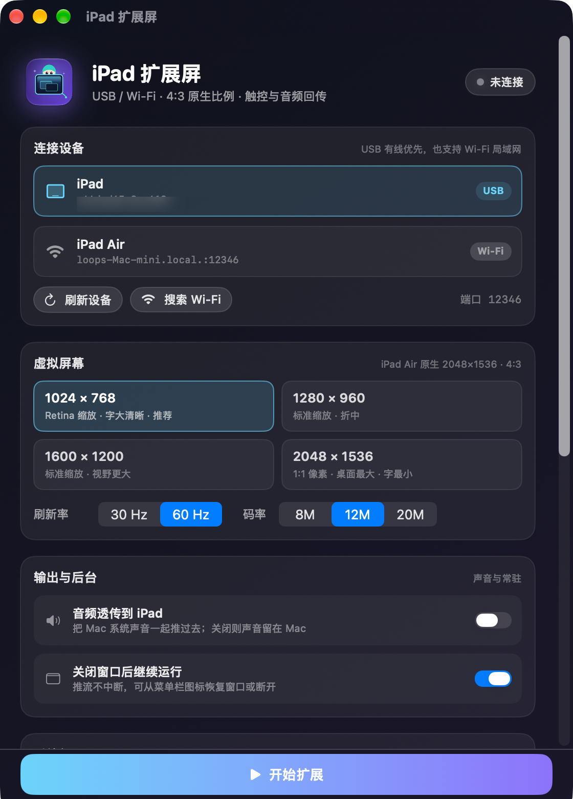
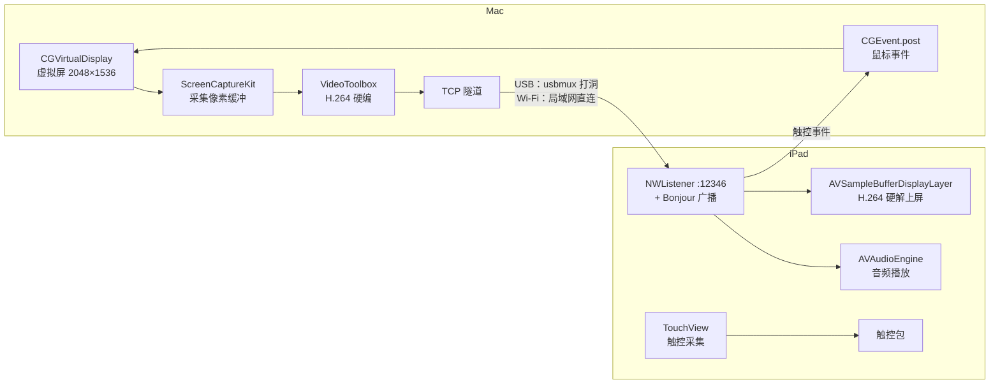

# iPad 扩展屏 · iPad Extended Display

把一台跑不动 Sidecar 的老 iPad（甚至 iOS 12）变成 Mac 的第二块屏幕：**USB 有线或 Wi‑Fi 局域网、4:3 原生比例、H.264 硬解上屏、触控反向回传、可选音频透传**。



这个项目一开始只是想验证一件事：一台 iOS 12.5.8 的 iPad Air 1，官方 Sidecar 不支持、Duet 新版要 iOS 13、Splashtop XDisplay 又依赖已废弃的内核扩展，那它到底还能不能当副屏？

结论是能，而且不需要装任何驱动或内核扩展：自签名 App 在 iPad 上监听一个端口并广播 Bonjour，Mac 通过 usbmux（就是 iTunes / Xcode 用来跟设备通信的那条 USB 通道）打洞进去，或者直接连局域网地址，把屏幕画面用 H.264 推过去，iPad 用 `AVSampleBufferDisplayLayer` 硬解显示。

> 想看这条路是怎么试出来的（Sidecar / Duet / kext 各自为什么走不通、两个真坑长什么样）：[docs/story.md](docs/story.md)

## 下载

到 [Releases](https://github.com/BestWaveRock/ipad-extended-display/releases/latest) 下载：

| 文件 | 说明 |
| --- | --- |
| `iPad-Extended-Display-<版本>.dmg` | Mac 端应用（macOS 14+，arm64 + x86_64 通用） |
| `iPadDisplay.ipa` | iPad 端应用（iOS 12+，需自签名） |

都不需要 Homebrew、不需要内核扩展、不需要 BetterDisplay。

## 特性

- **双通道**：USB 走 usbmux 通道，不依赖 Wi-Fi，不受路由器、5 GHz、隔墙影响，延迟稳定在个位数毫秒级；不想插线时切 Wi‑Fi，同一局域网内自动发现、自动连接。
- **原样 4:3**：iPad Air 原生 2048×1536，虚拟屏按 4:3 建，画面点对点没有黑边、没有拉伸。
- **不装驱动**：不需要内核扩展（kext），不需要关闭 SIP，不需要改系统文件。
- **自带虚拟屏**：应用内直接创建虚拟显示器（`CGVirtualDisplay`），不再需要 BetterDisplay 之类的第三方工具。
- **零依赖**：自己实现了 usbmux 协议客户端，不需要 `iproxy`、不需要 `libimobiledevice`、不需要 Homebrew。
- **触控回传**：在 iPad 上点、拖、滑，Mac 上就是对应的鼠标事件，可以直接操作副屏窗口。
- **音频透传**（可选）：一个开关就能把 Mac 的系统声音一起推到 iPad，关掉则声音留在 Mac，互不干扰。
- **后台常驻**：关掉窗口不等于退出，推流不中断；菜单栏图标随时断开或重新打开窗口。
- **可调参数**：4 档分辨率、30/60Hz 刷新率、8/12/20 Mbps 码率，运行中可实时切换。
- **命令行版本**：附带同引擎的 CLI，方便脚本化或排障。

## 实测性能

测试机：iPad Air 1（iPad4,1，iOS 12.5.8） + Apple Silicon Mac，USB 2.0（480 Mbps）。

| 场景 | 帧率 | 码率 |
| --- | --- | --- |
| 静态桌面 | 5–15 fps（内容不变时编码器自动降帧） | 150–250 KB/s |
| 滚动网页 / 拖窗口 | 30–60 fps | 1.5–2 MB/s |
| 播放视频 | 30–60 fps | 3–6 MB/s |

USB 2.0 的带宽（理论 60 MB/s）远超 H.264 的需求，所以画面质量主要取决于 iPad 的硬解能力和码率设置，而不是链路。

同一张表在 Wi‑Fi 下也能达到，前提是 Mac 和 iPad 在同一台 5 GHz 路由器下、信号良好。开了音频透传再加约 192 KB/s（未压缩 PCM），依然远低于 5 GHz 的实际带宽。

## 工作原理



三段链路：

1. **虚拟显示器**：Mac 端用私有类 `CGVirtualDisplay` 在系统里注册一块 2048×1536 的虚拟屏，系统把它当成真的外接显示器，窗口可以拖过去。
2. **采集与编码**：`ScreenCaptureKit` 按虚拟屏 ID 采集像素，`VideoToolbox` 实时编成 H.264（Baseline/Main，无 B 帧，低延迟）。
3. **传输**：两条路，同一种包格式。
   - **USB**：Mac 直接连 `usbmuxd` 的 Unix socket，用 plist 协议请求「连接到设备 12346 端口」，之后这条 socket 就是一条裸 TCP 隧道。
   - **Wi‑Fi**：iPad 端 `NWListener` 注册 Bonjour 服务 `_ipaddisplay._tcp`，Mac 端用 `NetServiceBrowser` 发现后直接连局域网地址。

   iPad 端始终是 `NWListener` + `AVSampleBufferDisplayLayer`，收到包后硬解显示，两条路对它没有区别。

音频同理：开关打开后 `ScreenCaptureKit` 多输出一路 `.audio`，Mac 转成 48 kHz / 16 bit / 立体声裸 PCM 走同一条隧道，iPad 用 `AVAudioEngine` 播放。

触控走反方向：`UIGestureRecognizer` 级别的 `touchesBegan/Moved/Ended` → 归一化坐标 → 同一个隧道回传 → Mac 用 `CGEvent` 投递鼠标事件到虚拟屏坐标。

协议细节见 [docs/protocol.md](docs/protocol.md)。

## 系统要求

| 端 | 要求 |
| --- | --- |
| Mac | macOS 14 或更新（`CGVirtualDisplay` / ScreenCaptureKit 需要），Apple Silicon 或 Intel |
| iPad | iOS 12 或更新（iPad Air 1 / iPad 5 / 6 代等 4:3 机型效果最好） |
| 连接 | USB：Lightning 或 USB-C **数据线**（不是纯充电线）；Wi‑Fi：Mac 与 iPad 在同一局域网 |

## 快速开始

### 第一步：iPad 端安装 App

项目提供已打包好的 `iPadDisplay.ipa`（`ios/iPadDisplay.ipa`，也可从 Releases 下载）。

因为这是自签名应用，需要用 **iLoader**（或 SideStore / AltStore 这类工具）装进 iPad：

1. 在 Mac 上打开 iLoader，用 Apple ID 登录（免费账号即可）。
2. 设备列表里选中你的 iPad，点「导入 IPA」，选择 `iPadDisplay.ipa`。
3. 点安装，等待进度完成。
4. iPad 桌面上会出现 **iPad 扩展屏** 图标，点开它。
5. 如果提示「不受信任的开发者」，去 iPad 的 `设置 → 通用 → VPN 与设备管理` 里信任你的 Apple ID 证书。

> **关于 iLoader**：它是一个 iOS 侧载（sideload）工具，作用是拿你的 Apple ID 给 IPA 重新签名，让系统允许安装非 App Store 应用。免费 Apple ID 签出来的证书 **7 天过期**，过期后 App 打不开，回到 iLoader 重新签一次即可（数据不会丢）。这也是为什么本项目必须开源：你随时可以自己重新打包、重新签名。

打开 App 后它会长这样：黑屏 + 一行 `等待 Mac 连接…已广播 _ipaddisplay._tcp · :12346`。**请保持 App 在前台、不要锁屏**（iOS 12 会在切后台时挂起进程，画面会中断，回到前台会自动恢复）。

### 第二步：Mac 端安装

1. 打开下载到的 `iPad-Extended-Display-<版本>.dmg`，把 **iPad 扩展屏** 拖进「应用程序」。

   > 必须真的拖进「应用程序」再运行。直接在磁盘映像里双击，App 会以随机路径（App Translocation）启动，macOS 的权限记录每次都记不住，表现为“我明明授权了却还说没权限”。应用检测到这种情况会在顶部弹出红色提示。

2. 首次打开会被 Gatekeeper 拦一下（应用是 ad-hoc 签名，没有 Apple 公证）：右键点图标 →「打开」，或到 `系统设置 → 隐私与安全性` 里点「仍要打开」。
3. 按提示授权两项权限：
   - **屏幕录制**：采集虚拟屏画面必需。授权后需要**退出并重新打开应用**才生效。
   - **辅助功能**：把 iPad 上的触控变成 Mac 上的鼠标点击。不授权也能看画面，但点不动。
   - **本地网络**（macOS 15 及以上，走 Wi‑Fi 时才会弹）：允许应用在局域网里发现 iPad。
4. 用数据线连接 iPad，iPad 上点「信任」。
5. 应用里点「刷新设备」，选中你的 iPad，点「开始扩展」。

成功后系统会多出一块显示器，把窗口往那个方向拖就行。iPad 上会立刻出现画面。

不插线也能用：让 iPad 和 Mac 连同一个 Wi‑Fi，iPad 端 App 打开并停在前台，Mac 端点「搜索 Wi‑Fi」，几秒后设备列表里会出现一台标着 `Wi-Fi` 的 iPad，名字就是 iPad 的设备名。选中它点「开始扩展」即可。

> USB 和 Wi‑Fi 可以同时出现在列表里，随时切换。同一个局域网建议走 5 GHz；2.4 GHz 或信号差的时候，画面会明显比 USB 抖。

### 第三步：调整

- **分辨率**：`1024×768` 是推荐值——虚拟屏以 2 倍渲染，实际像素 2048×1536，正好是 iPad Air 的原生分辨率，字大且清晰。想要更大桌面就选 `2048×1536`（1:1 像素，但字会很小）。
- **刷新率**：30Hz 更省电、更省带宽；60Hz 更跟手。运行中切换会自动重连。
- **码率**：8 Mbps 适合看文档，20 Mbps 适合看视频/图片。
- **音频透传**：打开后 Mac 的系统声音（视频、音乐、会议）会一起送到 iPad 播放；关掉则声音留在 Mac。运行中切换会自动重连一次。注意音源是系统混音，不是单个 App，所以无法做到「只把某个 App 的声音送过去」。
- **后台常驻**：「关闭窗口后继续运行」打开时，点红叉只是把窗口收起来，推流不中断，可以从菜单栏图标重新打开窗口、断开或退出。默认开启。

## 命令行版本

`mac/ipad-usb-display` 是同一套引擎的 CLI，方便排障：

```bash
cd mac
./build.sh
./ipad-usb-display --preset 1024 --refresh 60 --bitrate 12
```

参数：

| 参数 | 说明 |
| --- | --- |
| `--preset` | `1024` / `1280` / `1600` / `2048` |
| `--refresh` | `30` 或 `60` |
| `--bitrate` | 码率，单位 Mbps |
| `--port` | iPad 端监听端口，默认 `12346` |
| `--host` | 不连 iPad，改连指定地址（排障用：`--host 127.0.0.1 --port 23457` 可以只验证采集与编码） |

接上设备后正常输出：

```
[22:44:23] 设备 0f3c9a51…7d2b8e
[22:44:25] 虚拟屏 1024 × 768 · 像素 2048×1536
[22:44:26] 隧道已建立 (fd 3)
[22:44:26] 开始采集 2048×1536 @60fps
[22:44:27] 20.7 fps · 0.7 MB/s · 触控 0 · 丢帧 0
[22:45:32] 30.9 fps · 0.2 MB/s · 触控 2 · 丢帧 0
```

桌面静止时帧率会掉到 0（ScreenCaptureKit 只在画面变化时出帧），这是正常的省带宽行为，iPad 上会一直显示最后一帧。

## 从源码构建

```bash
# Mac 应用（生成 build/iPad 扩展屏.app）
./src/build-app.sh

# DMG 安装包（生成 dist/iPad-Extended-Display-1.0.2.dmg）
./package.sh

# iPad 端 IPA（生成 ios/iPadDisplay.ipa）
./ios/build.sh
```

构建 IPA 需要 Xcode 命令行工具（`xcode-select --install`），并会把产物复制到 `~/Downloads/iPadDisplay.ipa`。

发布用的 DMG 默认构建 arm64 + x86_64 通用二进制；只想跑本机构建可以 `ARCHS=arm64 ./src/build-app.sh`。

打 tag 时 GitHub Actions 会自动构建并把它挂到对应 Release：

```bash
git tag v1.0.2 && git push origin v1.0.2
```

工作流定义在 [.github/workflows/release.yml](.github/workflows/release.yml)。

## 分辨率与画面比例

iPad Air 1/2、iPad 5/6 代、iPad Pro 9.7 的屏幕都是 **2048×1536（4:3）**，逻辑分辨率 1024×768 @2x。本项目默认按这个尺寸建虚拟屏，所以画面是点对点的。

其他机型（iPad 10.2" 是 2160×1620，iPad Air 4/5 是 2360×1640，iPad Pro 12.9" 是 2732×2048）也能用，但需要调整 `src/VirtualDisplay.swift` 里的 `pixelWidth` / `pixelHeight` 与预设列表，否则画面会被 iPad 缩放，略微发虚。

## 第三方工具说明

为了避免误会，这里说清楚每个外部工具在整条链路中的角色：

| 工具 | 是否必需 | 作用 |
| --- | --- | --- |
| **iLoader** | 必需（iPad 端） | iOS 侧载工具，用你的 Apple ID 给 `iPadDisplay.ipa` 重新签名并安装。免费账号签名 7 天过期。同类替代品：SideStore、AltStore、Sideloadly。 |
| **BetterDisplay** | **不再需要** | 早期原型用它的虚拟屏功能做验证，现在 Mac 端用 `CGVirtualDisplay` 自己建虚拟屏，完全独立。若你已经在用 BetterDisplay 管理多显示器，二者不冲突。 |
| **libimobiledevice / iproxy** | **不再需要** | 早期原型靠 `iproxy` 转发端口。现在应用内置了 usbmux 客户端，直接和 `usbmuxd` 通信。 |
| **Xcode 命令行工具** | 仅构建时需要 | 编译 Swift 源码、打包 IPA。普通用户用现成的 DMG 即可。 |

## 常见问题

**iPad 上一直显示「等待 Mac 连接」**

先确认数据线能传数据（换一根线试试），iPad 上要点「信任此电脑」。然后在应用里点「刷新设备」，确认设备标签是 `USB` 而不是「网络」。如果 iPad App 被切到后台或锁屏，它会停止监听，重新打开即可。

**点「搜索 Wi‑Fi」搜不到 iPad**

四个前提：iPad 端 App 打开且在前台、两台机器连的是同一个 Wi‑Fi、路由器没开 AP 隔离（公司/酒店网络常见）、iPad 没开飞行模式。还是搜不到就把两台机器都连到同一个手机热点试一次，能搜到就说明是路由器屏蔽了 Bonjour 组播。

**设备列表里怎么区分 iPad 和 iPhone**

usbmux 只给得到 USB 产品 ID，给不到机型名，所以应用是按 ID 推断的：`4779` 显示 iPad、`4776` 显示 iPhone，其它一律显示「iOS 设备」。想确认是哪台，看下面那行 UDID 前 8 位/后 6 位。Wi‑Fi 那一行显示的是 iPad 的真实设备名（Bonjour 服务名），所以同一台 iPad 可能同时出现 USB 和 Wi‑Fi 两条。

**有画面但 iPad 没声音**

先确认「音频透传」是打开的（打开后会自动重连一次，日志里会出现「音频透传已开启」），再检查 iPad 的侧边静音键/音量，以及 App 是否在前台。iPad 端只在推流开始时收到一次音频格式，之后按 48 kHz 立体声播放。

**有画面但点不动**

辅助功能权限没给。去 `系统设置 → 隐私与安全性 → 辅助功能` 勾选「iPad 扩展屏」，然后重启应用。

**点「开始扩展」提示缺少屏幕录制权限**

去 `系统设置 → 隐私与安全性 → 屏幕录制` 勾选「iPad 扩展屏」，然后**完全退出应用再打开**。macOS 只在进程启动时检查这个权限。

**系统设置里明明已经打开，应用还是说没有权限**

这是 ad-hoc 签名 + TCC 的老问题，通常有三种成因，应用里都有对应的按钮：

1. **应用没放在「应用程序」里**：直接在 DMG 里双击运行，路径每次不同（App Translocation），授权永远对不上。顶部会出现红色提示「请先安装到「应用程序」」。
2. **授权后没重启**：屏幕录制权限只在进程启动时读取。授予后应用会自行发现并弹出「权限已生效，需要重启应用」，点「立即重启」即可。
3. **旧授权记录残留**：每次重新构建（包括换版本）二进制哈希都会变，而 ad-hoc 签名没有稳定的开发者身份，系统里可能留着一条对不上的旧记录，于是“开关是开的但不生效”。点权限卡片里的 **「重置权限」**（内部执行 `tccutil reset ScreenCapture/Accessibility com.loop.ipadextendeddisplay` 并自动重启），重启后再授权一次就好。

**画面很卡 / 掉帧**

先把码率降到 8 Mbps、刷新率降到 30Hz。另外确认 iPad 没有处于低电量模式（会限制解码性能），并且 App 在前台。

**虚拟屏在「显示器」设置里删不掉**

虚拟屏的生命周期跟创建它的进程绑定，退出应用后它会自动消失。如果残留，注销一次或重启即可。

**7 天后 App 打不开**

免费 Apple ID 签名过期了。用 iLoader 重新签名安装一次，数据不会丢。

**装好后桌面图标是空白的**

早期版本在 `Info.plist` 里写了 `CFBundleIconName = AppIcon`，但没有对应的 `Assets.car` 资产目录，系统找不到图标就画成空白。现在已去掉这个键，改为完整的 `CFBundleIconFiles` 列表（含 iPad 需要的 76/83.5 尺寸，且全部去掉 alpha 通道）。

重装后如果还是空白，是 SpringBoard 的图标缓存没刷新：先删掉旧图标，重启一次 iPad 再装。

## 已知限制

- iPad 端 App 必须在前台，iOS 12 不支持后台保持网络监听。
- 推画面、触控和可选的系统音频：键盘输入、剪贴板同步、Apple Pencil 压感还没做。
- Wi‑Fi 模式依赖局域网质量：同一台 5 GHz 路由器下通常很跟手，2.4 GHz、隔墙或公共 Wi‑Fi 会明显变差（USB 模式下延迟是个位数毫秒）。链路不做丢包重传，靠 TCP 自己扛。
- Wi‑Fi 发现依赖 Bonjour（`_ipaddisplay._tcp`）。公司网络、酒店 Wi‑Fi 常有 AP 隔离或组播屏蔽，这种情况下发现不到设备，改回 USB 或自己搭热点即可。
- 虚拟屏切换分辨率偶尔会被系统拒绝一次（`CGErrorFailure`），代码里做了重试，极少数情况下需要再点一次。
- 触控坐标按整屏归一化映射；当 iPad 上的画面有黑边（分辨率比例不是 4:3）时，边缘区域会有偏移。
- ad-hoc 签名 + 无公证：首次启动需要右键打开，且每次重新构建后 TCC 权限可能需要重新授权。
- 未在 Intel Mac 上实测。

## 更新日志

### 1.0.4

- 修复设备列表把所有 iOS 设备都叫「iPad」：现在按 usbmux 暴露的 USB 产品 ID 区分（`4779` → iPad、`4776` → iPhone），认不出来时显示「iOS 设备」，不再冒充 iPad。
- iPad 设备排在列表最前，USB 优先于 Wi-Fi；选中非 iPad 设备时会提示需要先安装 iPad 端 App。

### 1.0.3

- 修复「Mac 点开始扩展，iPad 端 App 闪退」：iOS 12 的 `AVAudioEngine` 对 16 bit 交错格式会抛异常，改用最通用的 Float32 非交错格式。
- 音频初始化套了一层 ObjC 异常护栏：即使音频子系统拒绝启动，也只在 iPad 上提示「音频不可用，画面继续」，视频推流不受影响。
- iPad 端音频状态收敛到独立串行队列，播放排队限制在 1 秒以内，避免断流后延迟越积越大。

### 1.0.2

- 新增 **Wi‑Fi 传输**：iPad 端广播 Bonjour 服务 `_ipaddisplay._tcp`，Mac 端点「搜索 Wi‑Fi」自动发现，USB / Wi‑Fi 设备出现在同一个列表里，随时切换。
- 新增 **音频透传开关**：打开时把 Mac 系统声音以 48 kHz / 16 bit / 立体声裸 PCM 推到 iPad 播放，关掉则声音留在 Mac。
- 新增 **后台常驻**：关闭窗口不再退出，推流继续；菜单栏图标可查看状态、断开、恢复窗口、退出。
- iPad 端提示语加了深色底板，白色画面或断线时也能看清文字。

### 1.0.1

- 修复「系统设置里已授权但应用仍提示没权限」，加了权限重置按钮。
- DMG 改为 arm64 + x86_64 通用二进制。
- 接入 GitHub Actions：打 tag 自动构建并发布 Release。

## 许可

[MIT](LICENSE)。欢迎提 issue 和 PR，尤其是其他 iPad 型号的分辨率预设、Apple Pencil、键盘输入方向。
